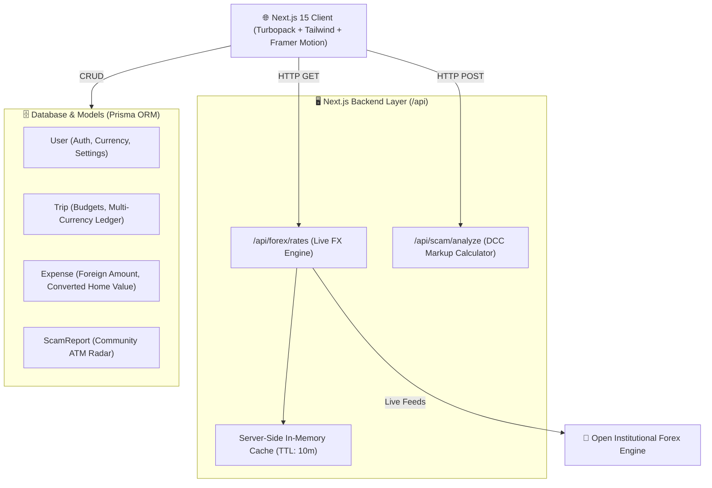

<div align="center">

  

  # 🌐 GlobeRate
  ### ⚡ The Intelligent Travel Finance & ATM Scam Defense Platform

  <p align="center">
    <a href="https://globe-rate.vercel.app">
      
    </a>
  </p>

  <p align="center">
    <a href="https://globe-rate.vercel.app" target="_blank">
      
    </a>
    
    
    
    
  </p>

</div>

---

## 📸 Visual Showcase & Platform Tour

<table>
  <tr>
    <td width="50%" align="center">
      <h3>🚀 1. Travel Smarter Hero Showcase</h3>
      
      <p><i>Real-time scam protection benchmarks & travel superpower onboarding.</i></p>
    </td>
    <td width="50%" align="center">
      <h3>📸 2. Nova AI Vision Lens</h3>
      
      <p><i>Point your camera at foreign menus and receipts for live ₹ INR conversion.</i></p>
    </td>
  </tr>
  <tr>
    <td width="50%" align="center">
      <h3>🛡️ 3. Airport ATM Scam Exposer</h3>
      
      <p><i>Unmasking 8%–14% hidden DCC markups and guiding users to zero-fee bank ATMs.</i></p>
    </td>
    <td width="50%" align="center">
      <h3>🌊 4. The Flowing Budget River</h3>
      
      <p><i>Fluid, visual multi-currency burn rate tracking across European and Asian trips.</i></p>
    </td>
  </tr>
</table>

<div align="center">
  <h3>🌟 5. Loved by Global Travelers</h3>
  
  <p><i>"The Scam Detector literally saved me ₹12,000 at Bangkok airport on my first day."</i></p>
</div>

---

## ⚡ Core Engineering Capabilities

* **🛡️ Dynamic Currency Conversion (DCC) Engine**: Algorithmic detector comparing foreign booth rate offers against true mid-market benchmarks to expose hidden 8% to 14% fees.
* **📸 Nova AI Optical Vision**: Automated optical parser reading foreign currencies (JPY, EUR, THB, USD) and instantly converting totals to home currency.
* **🌊 The Budget River**: High-impact visual telemetry calculating daily burn rates and issuing warnings before travelers overspend.
* **⚡ Live Institutional Forex API**: Built-in backend route with an in-memory 10-minute cache to stream real-time rates for 160+ countries without rate-limit lag.
* **📴 Zero-Roaming Offline Vault**: Cached top 50 global forex rates and embassy helplines accessible without an international roaming SIM card.

---

## 🏗️ Full-Stack System Architecture



---

## 🔌 Live Backend API Endpoints

### 1. Live Forex Engine
* **Endpoint**: `GET /api/forex/rates?base=USD`
* **Response**:
```json
{
  "success": true,
  "source": "live_forex_engine",
  "base": "USD",
  "rates": {
    "INR": 95.90,
    "EUR": 0.895,
    "JPY": 158.54,
    "GBP": 0.756,
    "THB": 33.61
  }
}
```

### 2. Algorithmic Scam Risk Analyzer
* **Endpoint**: `POST /api/scam/analyze`
* **Payload**:
```json
{
  "fromCurrency": "EUR",
  "toCurrency": "INR",
  "amountOffered": 100,
  "amountToPay": 8200
}
```
* **Response**:
```json
{
  "success": true,
  "analysis": {
    "realMidMarketRate": 95.90,
    "hiddenMarkupPercent": 14.49,
    "lossInHomeCurrency": 1390,
    "riskTier": "PREDATORY_SCAM",
    "recommendation": "Severe markup detected! Airport booth is hiding large fees."
  }
}
```

---

## 💻 Local Development Setup

1. **Clone the repository:**
   ```bash
   git clone https://github.com/Snehachoudhary26/Globe_-Rate.git
   cd Globe_-Rate
   ```

2. **Install dependencies:**
   ```bash
   npm install
   ```

3. **Initialize Prisma Database:**
   ```bash
   npx prisma generate
   npx prisma db push
   ```

4. **Run the local development server:**
   ```bash
   npm run dev
   ```
   Open [http://localhost:3000](http://localhost:3000) in your browser.

---

<div align="center">
  <p>Built with ❤️ for global travelers worldwide.</p>
  <p><b><a href="https://globe-rate.vercel.app">Visit Live Website →</a></b></p>
</div>
