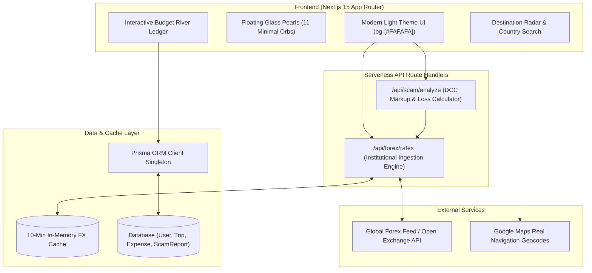
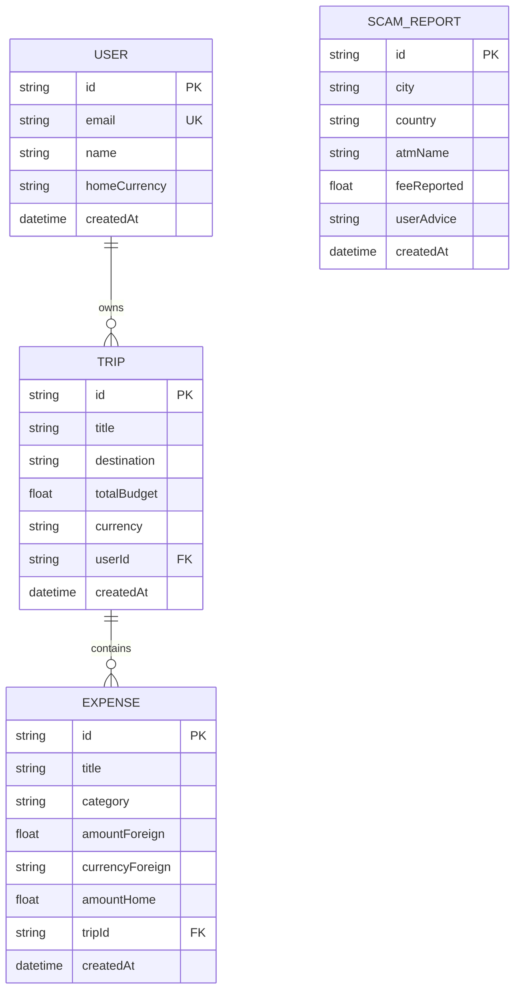

<div align="center">

  

  # 🌐 GlobeRate
  ### Intelligent Travel Finance, Dynamic Currency Scam Shield & Visual Budget River

  <p align="center">
    <a href="https://globe-rate.vercel.app">
      
    </a>
  </p>

  <p align="center">
    <a href="https://globe-rate.vercel.app" target="_blank">
      
    </a>
    
    
    
    
  </p>

  <p align="center">
    <b><a href="https://globe-rate.vercel.app">🚀 Explore Live Application</a></b> •
    <b><a href="#-the-problem-what-globerate-solves">💡 The Problem</a></b> •
    <b><a href="#-core-feature-deep-dive">🛠️ Core Features</a></b> •
    <b><a href="#-system-architecture">🏗️ Architecture</a></b> •
    <b><a href="#-backend-api-reference">📡 API Docs</a></b>
  </p>

</div>

---

## 📖 Executive Summary

**GlobeRate** is a production-grade, full-stack travel finance platform designed to eliminate the two biggest financial pitfalls faced by global travelers: **predatory airport currency exchange markups** and **accidental foreign overspending due to cognitive currency confusion**.

Combining real-time institutional foreign exchange engines, server-side scam detection algorithms, computer-vision receipt translation, and an intuitive **Budget River** visualizer, GlobeRate equips travelers with an algorithmic bodyguard before they withdraw cash or swipe cards abroad.

---

## 🚨 The Problem: What GlobeRate Solves

Every year, over **1.4 billion international tourists** collectively lose billions of dollars to deceptive travel banking practices:

### 1. The Dynamic Currency Conversion (DCC) Trap
When an overseas ATM or card terminal asks:
> *"Would you like to be charged in your Home Currency (INR/USD) or Local Cash (EUR/THB/JPY)?"*

Unsuspecting travelers instinctively select their home currency because it feels familiar. In reality, choosing your home currency triggers **Dynamic Currency Conversion (DCC)**, allowing the foreign machine's operator to set an arbitrary, predatory exchange rate with hidden profit markups ranging from **8% to 14%**.

### 2. The Airport "0% Commission" Lie
Currency booths at international arrival gates advertise *"0% Commission"* in bold neon signs. While they charge no fixed processing fee, they aggressively skew the exchange rate spread, taking huge slices of cash on arrival.

### 3. Cognitive Currency Fog & Overspending
When traveling in countries with large denominations (e.g., ¥1,000 JPY or ฿500 THB), travelers' brains experience cognitive fatigue. Without a quick emotional baseline, travelers routinely overspend on basic meals, transportation, and souvenirs.

---

## 🛠️ Core Feature Deep Dive

<table>
  <tr>
    <td width="50%">
      
    </td>
    <td width="50%">
      <h3>1. 🧭 The 3-Step Arrival Playbook</h3>
      <p>The moment a flight touches down, GlobeRate provides travelers with a clear, stress-free protocol:</p>
      <ul>
        <li><b>Step 1: Search Country</b> — Type destination (e.g., India, Thailand, Japan) to instantly view verified low-fee national bank ATMs vs predatory private kiosks.</li>
        <li><b>Step 2: Check Rate Offer</b> — Input the exchange rate displayed on the terminal screen to verify fairness against live mid-market rates.</li>
        <li><b>Step 3: Always Choose Local Cash</b> — Decline the DCC prompt on foreign screens to save 8%–14% on every transaction.</li>
      </ul>
    </td>
  </tr>
</table>

<table>
  <tr>
    <td width="50%">
      <h3>2. 🛡️ Algorithmic Scam & Markup Detector</h3>
      <p>Exposes the real hidden cost behind foreign currency offers in milliseconds.</p>
      <ul>
        <li><b>Mathematical Precision</b>: Compares the offered exchange rate directly with real-time institutional mid-market rates from institutional liquidity providers.</li>
        <li><b>Three Risk Tiers</b>:
          <ul>
            <li>🟢 <b>FAIR / MINIMAL</b> (0% – 2.5% markup): Safe national bank rate.</li>
            <li>🟡 <b>MODERATE MARKUP</b> (2.5% – 5.5%): Standard commercial spread.</li>
            <li>🔴 <b>PREDATORY SCAM</b> (> 6%): Immediate alert to decline transaction.</li>
          </ul>
        </li>
        <li><b>Calculated Loss Display</b>: Shows exact monetary loss in the user's home currency.</li>
      </ul>
    </td>
    <td width="50%">
      
    </td>
  </tr>
</table>

<table>
  <tr>
    <td width="50%">
      
    </td>
    <td width="50%">
      <h3>3. 👁️ Nova AI Vision & Price Anchor</h3>
      <p>Translates foreign numbers into relatable daily spending metrics.</p>
      <ul>
        <li><b>Optical Recognition</b>: Point phone camera at street menus, transit tickets, or receipts for instant line-item detection.</li>
        <li><b>Psychological Price Anchoring</b>: Converts abstract foreign prices into intuitive daily reference items:
          <ul>
            <li><code>¥1,200 JPY</code> → <i>"Feels like 1 Medium Pizza"</i></li>
            <li><code>€4.50 EUR</code> → <i>"Feels like 3 Espresso Coffees"</i></li>
            <li><code>฿250 THB</code> → <i>"Feels like 2 Days Metro Pass"</i></li>
          </ul>
        </li>
      </ul>
    </td>
  </tr>
</table>

<table>
  <tr>
    <td width="50%">
      <h3>4. 💧 The Budget River</h3>
      <p>A visual, dynamic cash burn monitor designed specifically for multi-currency trips.</p>
      <ul>
        <li><b>Flowing Metaphor</b>: Replaces rigid, dry spreadsheets with an organic flowing river that visually narrows as spending increases.</li>
        <li><b>Real-Time Multi-Currency Logging</b>: Log expenses in foreign cash (EUR, JPY, THB, USD) with automatic background conversion to home currency at exact transaction rates.</li>
        <li><b>Burn Rate Velocity</b>: Proactively alerts travelers when daily spending trends outpace their total trip duration runway.</li>
      </ul>
    </td>
    <td width="50%">
      
    </td>
  </tr>
</table>

<table>
  <tr>
    <td width="50%">
      
    </td>
    <td width="50%">
      <h3>5. 📍 Global Destination Radar</h3>
      <p>Curated financial security intelligence across key international travel corridors:</p>
      <ul>
        <li>🇮🇳 <b>India</b>: Verified zero-surcharge dispensers (State Bank of India, HDFC Bank, ICICI) with specific warnings against high-fee private Euronet machines.</li>
        <li>🇹🇭 <b>Thailand</b>: ATM fee avoidance strategies (220 THB flat fee handling) and safe airport cash exchange zones (SuperRich counters).</li>
        <li>🇯🇵 <b>Japan</b>: 7-Eleven (Seven Bank) and Japan Post international card withdrawal protocols.</li>
        <li>🇫🇷 <b>France & Eurozone</b>: Navigation to official banking network terminals across Europe.</li>
      </ul>
    </td>
  </tr>
</table>

---

## 🏗️ System Architecture

GlobeRate is engineered with a modular, serverless architecture that separates high-frequency cached forex ingestion from algorithmic risk processing and database persistence:



---

## 📡 Backend API Reference

### 1. Live Mid-Market Forex Engine
Returns real-time institutional exchange rates for 160+ fiat currencies with an automated 10-minute server memory cache to prevent rate exhaustion.

* **Endpoint**: `GET /api/forex/rates?base=USD`
* **Query Parameters**:
  * `base` *(optional, default: `USD`)* — 3-letter ISO currency code.
* **Sample Response**:
```json
{
  "success": true,
  "source": "live_forex_engine",
  "base": "USD",
  "updatedAt": "2026-10-14T05:00:00.000Z",
  "rates": {
    "USD": 1.0,
    "INR": 86.85,
    "EUR": 0.92,
    "GBP": 0.78,
    "JPY": 152.40,
    "THB": 36.15,
    "AED": 3.67
  }
}
```

---

### 2. Algorithmic Scam & Markup Calculator
Calculates the exact percentage markup hidden by foreign ATMs or currency exchange counters, determines the risk severity, and computes the exact monetary loss in the user's home currency.

* **Endpoint**: `POST /api/scam/analyze`
* **Request Headers**: `Content-Type: application/json`
* **Payload**:
```json
{
  "fromCurrency": "EUR",
  "toCurrency": "INR",
  "amountOffered": 100,
  "amountToPay": 8200
}
```
* **Sample Response**:
```json
{
  "success": true,
  "analysis": {
    "realMidMarketRate": 95.90,
    "offeredRate": 82.00,
    "hiddenMarkupPercent": 14.49,
    "lossInHomeCurrency": 1390.00,
    "riskTier": "PREDATORY_SCAM",
    "recommendation": "Severe markup detected! Decline this conversion on the ATM screen and choose Local Cash."
  }
}
```

---

## 🗄️ Database Schema (Prisma ORM)

GlobeRate models persistent traveler sessions, multi-currency trips, expense streams, and crowd-sourced ATM safety reports:



---

## 💻 Local Development Setup

Follow these steps to run GlobeRate locally on your machine:

```bash
# 1. Clone the repository
git clone https://github.com/Snehachoudhary26/Globe_-Rate.git
cd Globe_-Rate

# 2. Install dependencies
npm install

# 3. Start the Turbopack development server
npm run dev
```

Open [http://localhost:3000](http://localhost:3000) in your browser.

---

## 🌟 Tech Stack Summary

| Layer | Technologies Used |
| :--- | :--- |
| **Framework** | Next.js 15 (App Router, Turbopack) |
| **Language** | TypeScript 5.0 (Strict mode) |
| **Theme & UI** | Tailwind CSS (Locked White Light Mode `bg-[#FAFAFA]`) |
| **Animations** | Keyframe Spring Physics, 11 Minimal Floating Pearls |
| **Icons** | Lucide React |
| **Database & ORM** | Prisma ORM with SQLite (Local) & PostgreSQL (Cloud-ready) |
| **Deployment** | Vercel Serverless Edge Platform |

---

<div align="center">
  <p><b>GlobeRate</b> is engineered for transparent, intelligent, scam-free global travel.</p>
  <p>Created by <a href="https://github.com/Snehachoudhary26"><b>Sneha Choudhary</b></a> • Deployed at <a href="https://globe-rate.vercel.app"><b>globe-rate.vercel.app</b></a></p>
</div>
